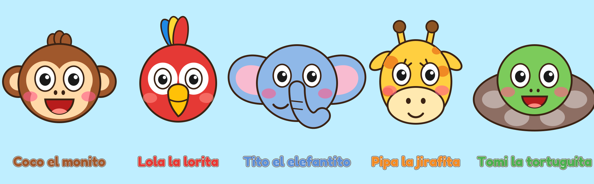

# Cuentos mágicos de la selva 🐒🌙

Canal infantil de YouTube con historias cortitas de animales de la selva: Coco, Lola, Tito, Pipa y Tomi.

## Qué hay en cada carpeta
| Carpeta | Contenido |
|---|---|
| `videos/` | Intro del canal, shorts (`shorts/`) y los primeros episodios. Desde el episodio 6 los videos largos no se suben a GitHub (pesan mucho): se generan con el código y se guardan en la PC o en Google Drive. |
| `imagenes/` | Logo de perfil (1024×1024), banner del canal (2560×1440) y ficha de personajes. |
| `codigo/` | Todo lo que dibuja y anima: personajes, escenarios, música, intro y episodios. |
| `fuentes/` | Tipografía de los títulos (Fredoka, licencia libre OFL). |

## Episodios
1. **Coco se va a dormir** — `videos/ep01_coco_se_va_a_dormir.mp4` (40 s)
2. **El puente del río** — `videos/ep02_el_puente_del_rio.mp4` (2 min 11 s, con intro). Coco quiere bananas del otro lado del río, el puente está roto y Tito hace un puente con la trompa. *Mensaje: juntos se puede.*
3. **¿Dónde está Tomi?** — `videos/ep03_donde_esta_tomi_youtube.mp4` (2 min 5 s, con intro). Los amigos juegan a las escondidas; Tomi se esconde en su caparazón entre las piedras y se queda dormido. *Mensaje: los amigos se cuidan.*
4. **La lluvia mágica** — `videos/ep04_lluvia_magica_youtube.mp4` (1 min 56 s, con intro). Llueve en la selva y Tito abre sus orejas como paraguas; después sale el arcoíris y saltan en los charcos. *Mensaje: después de la lluvia sale el sol.*
5. **El cumpleaños de Tomi** — `videos/ep05_cumple_tomi_youtube.mp4` (1 min 56 s, con intro). Los amigos le preparan una fiesta sorpresa a Tomi con globos, banderines, torta de bananas y una canción original. *Mensaje: los amigos se acuerdan de vos.*
6. **Tito se va a dormir** — 1 min 5 s con intro (el MP4 largo no está en GitHub: se genera con `codigo/ep06_tito_a_dormir.py`). Tito bosteza, Lola le canta y se duermen bajo una hoja. *Para la lista "A dormir con…"*
7. **La estrella que se cayó** — 1 min 45 s con intro (`codigo/ep07_estrella.py`). Una estrellita bebé se cae a la selva; todos intentan devolverla y Lola la lleva volando. Agradece con un corazón de estrellas. *Para "A dormir con…"*

## Cómo seguir en un chat nuevo con Claude
Pedile que trabaje con este repositorio (GR2206/Cuentos-m-gicos). El archivo `CLAUDE.md` le explica el estilo y los personajes, así todo sale igual.
